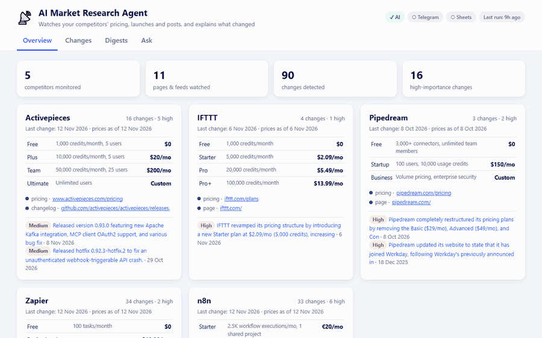
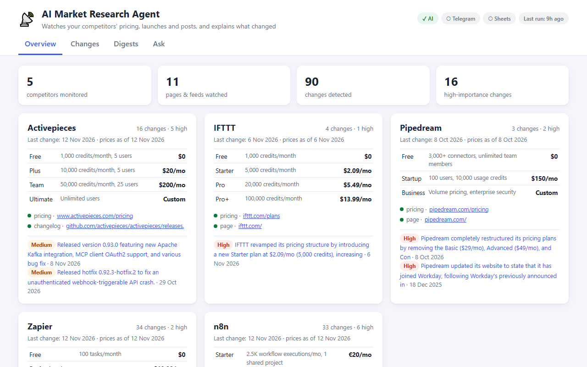
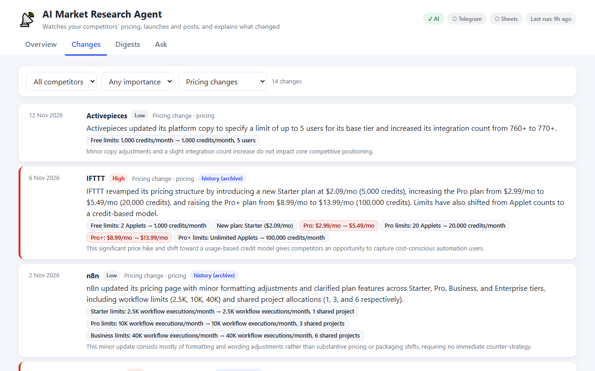
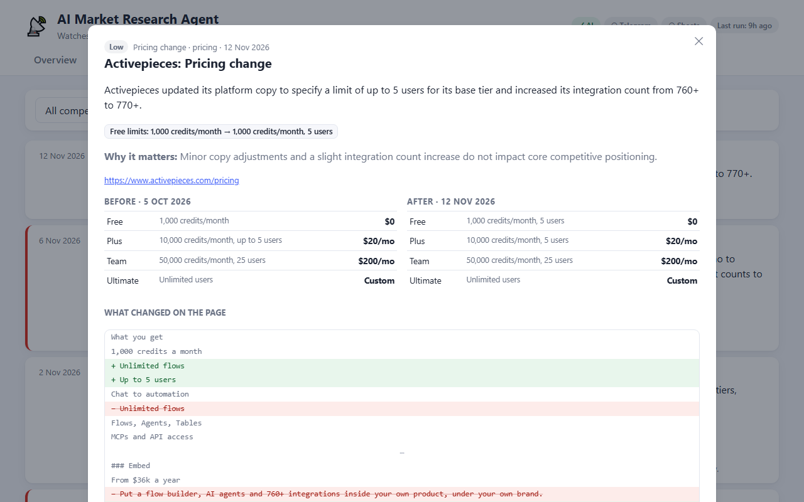
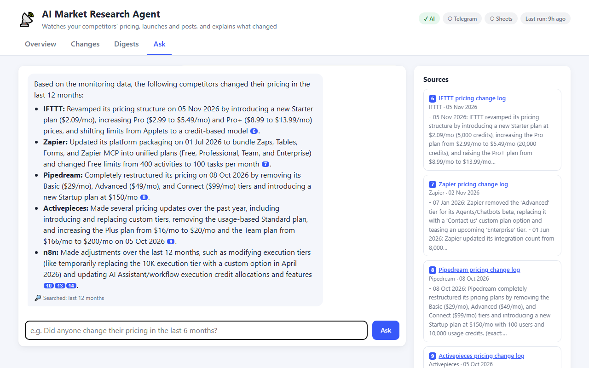
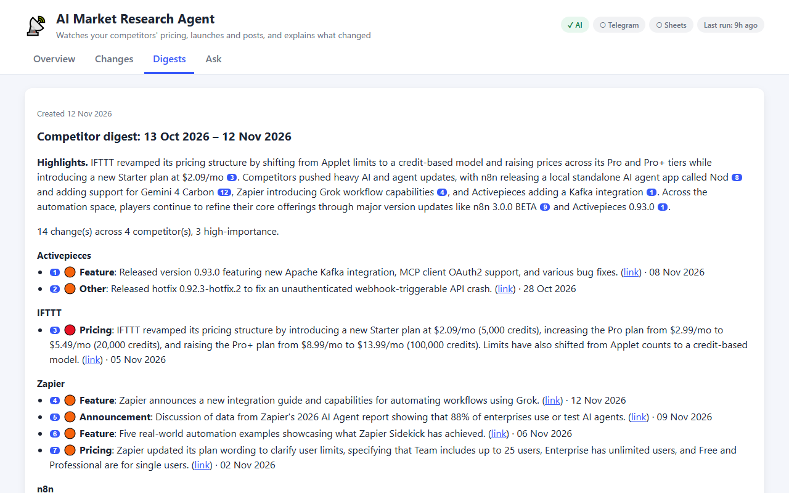

# 📡 AI Market Research Agent: competitor monitoring with RAG

An AI agent that **watches your competitors' websites** (pricing pages, changelogs, blogs), **detects what changed**, explains it in plain English and **alerts you on Telegram**. Everything it collects goes into a searchable knowledge base, so you can ask *"Did anyone raise prices this year?"* and get an answer **with sources**.

It runs **for free**: daily checks on GitHub Actions, a free-tier LLM (Google Gemini), local embeddings, Telegram and Google Sheets. No server and no card needed.

> 🏁 **Real-world demo:** the agent monitors five workflow-automation tools: **Zapier, n8n, Pipedream, Activepieces and IFTTT**. On day one, it pulled a year of their pricing history from the Wayback Machine and found the real price and plan changes shown below.

---

## 🎬 Demo

The dashboard: competitors and their current plans, the timeline of detected pricing changes, a before/after view of one change, then cited answers to questions about the market:



## 📸 Screenshots

**1. Overview.** Every competitor's current plans (extracted by AI from the pricing page), the pages being watched and their status, and the latest important changes:



**2. Change timeline.** Filter by competitor, importance or type. Pricing changes show the exact old → new prices:



**3. Change detail.** The plans before and after, side by side, and exactly which lines changed on the page:



**4. Ask questions.** Cited answers from the collected data. The question is narrowed down by competitor and time period first:



**5. Weekly digest.** An AI summary on top and every change grouped by competitor. It is also sent to Telegram every Monday:



---

## 📈 Real results (Nov 2025 – Nov 2026)

The 12-month backfill read **44 archived versions** of the five pricing pages, stored **50 blog and changelog posts** and found **28 page changes**. Every pricing change below was checked by hand against the archived pages:

| Date | Competitor | What changed (detected by the agent) |
|---|---|---|
| 5 Mar 2026 | Activepieces | Custom top plan renamed from *Ultimate* to *Unlimited* (and back on 12 Jul) |
| 6 Apr 2026 | n8n | The fixed 10K-executions tier replaced by a *custom number of executions* option |
| 1 Jul 2026 | Zapier | Plans repackaged so Zaps, Tables, Forms and MCP share one task pool |
| 13 Aug 2026 | Activepieces | Usage-based *Standard* plan replaced by **Free $0 / Plus $16 / Team $166** |
| 5 Oct 2026 | Activepieces | **Plus $16 → $20/mo, Team $166 → $200/mo** |
| 8 Oct 2026 | Pipedream | Basic $29 / Advanced $49 / Connect $99 replaced by a **Startup plan at $150/mo** |
| 5 Nov 2026 | IFTTT | Move to credits: new **Starter $2.09/mo**, **Pro $2.99 → $5.49**, **Pro+ $8.99 → $13.99** |

It also picked up non-pricing news, for example Pipedream joining Workday (Dec 2025) and n8n launching its local agent app *Nod* and the n8n 3.0 beta (Oct–Nov 2026). A second run on the same day found **0 changes and made 0 AI calls**, so nothing is ever alerted twice.

## ✨ Features

- **Watches pages, feeds and sitemaps.** Pricing and product pages (HTML), blogs and changelogs (RSS/Atom, e.g. GitHub releases), and sitemaps (new URLs = new posts). JavaScript-built pages can be rendered with Playwright (`render: true`).
- **Only real changes count.** Before comparing, it strips noise ("5 minutes ago", dates, copyright years, cookie banners, rotating content, plus your own ignore patterns), so you aren't alerted about nothing.
- **Exact pricing, checked in code.** AI extracts each plan (name, price, period, limits) as JSON. The plans are then compared **in code**, and a price change only counts if the page text itself changed in that place, so "Pro: $20 → $24/mo" is exact and the AI's wording can't create false alerts.
- **AI explanations.** Each change gets a short summary, an importance level (high/medium/low), a category and *why it matters*. New blog posts are analysed in batches, one AI call per feed.
- **Free-tier friendly.** The AI only runs on real changes, results are cached by content, calls are spaced out and capped per run, and if the AI is unavailable, simple rules still produce a summary. A run never fails because of the AI.
- **RAG knowledge base with cited answers.** Current pages, pricing tables, posts and every detected change are embedded locally (ChromaDB + fastembed). Questions are filtered by **competitor and time period** first ("in the last 3 months", "this year", "in March"), price questions get the stored pricing tables as exact sources, "who changed prices?" and "what's new?" questions get the full list of detected changes from the database (so a busy release feed can't crowd out the important news), and off-topic questions are declined **without calling the AI**.
- **Telegram:** instant alerts for important changes, a **weekly digest**, a warning when a source keeps failing, and an optional bot for `/ask`, `/latest` and `/digest` from your phone.
- **Google Sheets:** every change logged as a row, a live **Pricing** tab, and an optional **Competitors** tab where the client can add or pause competitors **without touching code**.
- **History from day one:** a backfill pulls a year of archived pricing pages from the free **Wayback Machine** and runs them through the same change detector.
- **Runs itself on GitHub Actions:** a daily check and a Monday digest, free on public repos. The database is kept on a separate `data` branch, with a lock so two runs never overlap.
- **Safe and polite:** it respects `robots.txt`, waits between requests, reads only public pages and collects no personal data. Secrets come only from `.env` or GitHub Secrets and the Telegram token is redacted from logs. The same change is never alerted or logged twice, and scraped text is treated as data in every prompt (prompt-injection defence) and neutralised before going into Sheets (formula injection).
- **81 automated tests** that run offline with no API keys.

## 🛠 Tech stack

Python 3.11+ · httpx · BeautifulSoup · feedparser · SQLite · difflib · pydantic · OpenAI SDK (any compatible LLM: Gemini, Groq, Ollama, OpenAI) · ChromaDB · fastembed (`BAAI/bge-small-en-v1.5`) · FastAPI · Telegram Bot API · gspread · GitHub Actions · vanilla JS dashboard · pytest

## ⚙️ How it works

```
sources.yaml / Google Sheet ─► Collector ─► Snapshots (SQLite) ─► Change detector ─► AI analyst
  (competitors & pages)        (polite:     (text + hash)         (noise filter,      (summary,
                                robots.txt,                        diff, pricing        importance,
                                delays)                            compare in code)     why it matters)
                                                                          │
                       ┌──────────────────────────┬───────────────────────┼────────────────────┐
                       ▼                          ▼                       ▼                    ▼
              RAG index (Chroma)          Telegram alerts          Google Sheets         Weekly digest
              ► cited Q&A in the          & bot                    (Changes, Pricing,    (Telegram +
                dashboard / Telegram                               Competitors tabs)     dashboard)
```

1. **Collect.** Each page or feed is fetched politely and turned into clean text (headings and tables kept; menus, footers, scripts and banners removed).
2. **Detect.** Text is normalised (noise removed) and hashed. Same hash = nothing happened, and no AI call is made. Otherwise the old and new versions are diffed line by line.
3. **Price check.** For pricing pages, AI extracts the plans as JSON, and old and new plans are compared field by field in code.
4. **Explain.** The AI summarises the change, rates its importance and says why it matters.
5. **Notify.** Important changes go to Telegram right away. All changes go to Google Sheets and into the weekly digest.
6. **Remember.** The knowledge base is updated: the latest page versions replace old ones, and every change is kept as its own dated document, so history stays searchable.
7. **Answer.** A question → competitor and date filters → local embedding search → relevance gate → the LLM answers only from numbered sources and cites them.

## 📁 Project structure

```
market-research-agent/
├── agent/
│   ├── collector.py     # polite fetching: pages, RSS/Atom, sitemaps, optional JS rendering
│   ├── differ.py        # noise filtering, diffs, field-by-field pricing comparison
│   ├── analyzer.py      # AI: pricing JSON extraction, change & post analysis (cached, budgeted)
│   ├── pipeline.py      # one run: collect → detect → analyse → alert → sync
│   ├── backfill.py      # a year of history from the Wayback Machine + feeds
│   ├── storage.py       # SQLite: sources, snapshots, items, changes, pricing, digests
│   ├── indexer.py       # builds the RAG knowledge base (incremental)
│   ├── rag.py           # cited Q&A with competitor / date filters
│   ├── digest.py        # weekly digest
│   ├── sources.py       # sources.yaml or the client's "Competitors" Google Sheet tab
│   ├── notify/telegram.py, notify/sheets.py
│   ├── llm_client.py, vectorstore.py, chunker.py, config.py, models.py
│   └── cli.py           # python -m agent run | backfill | digest | ask | serve | bot ...
├── web/                 # FastAPI dashboard + static UI
├── sources.yaml         # the competitors and pages to watch
├── .github/workflows/   # monitor.yml (daily), digest.yml (Mondays)
├── scripts/ci_db.sh     # keeps the database on the "data" branch between runs
└── tests/               # offline: mocked websites, LLM, Telegram and Sheets
```

## 🚀 Setup

```bash
git clone https://github.com/awais1221/ai-market-research-agent.git
cd ai-market-research-agent
python -m venv venv
# Windows
venv\Scripts\activate
# macOS / Linux
source venv/bin/activate
pip install -r requirements.txt
```

Copy `.env.example` to `.env` and set at least `API_KEY` (a free Gemini key from <https://aistudio.google.com/apikey>). Telegram and Google Sheets are optional; see below.

## ▶️ Run

```bash
python -m agent backfill        # once: a year of pricing history from the Wayback Machine
python -m agent run             # check every competitor now (this is what runs daily)
python -m agent status          # what is monitored, last checks, changes per competitor
python -m agent ask "Which competitors changed their pricing this year?"
python -m agent digest --days 7 --send
python -m agent serve           # dashboard at http://127.0.0.1:8000
python -m agent bot             # answer /ask, /latest, /digest on Telegram while running
```

The first `ask` or `serve` downloads the small embedding model (about 130 MB) once.

## 🎯 Choosing competitors

Edit `sources.yaml`:

```yaml
competitors:
  - name: Zapier
    sources:
      - {type: pricing, url: "https://zapier.com/pricing"}
      - {type: blog, url: "https://zapier.com/blog/feeds/latest/", format: rss}
      - {type: page, url: "https://zapier.com/", ignore: ["Trusted by [\\d,]+"]}
```

Or let the client manage the list in **Google Sheets**: run `python -m agent sources --export-sheet` once to create the **Competitors** tab, then set `SOURCES_FROM_SHEET=true`. They can then add a row, or set `active` to `no`, and the next daily run picks it up. Invalid rows are skipped and reported on Telegram, and if the Sheet can't be reached, the last good list is used.

## 📲 Telegram (free)

1. In Telegram, open **@BotFather**, send `/newbot` and copy the token.
2. Send any message to your new bot, then open `https://api.telegram.org/bot<TOKEN>/getUpdates` and copy the number after `"chat":{"id":`.
3. Put both in `.env` (`TELEGRAM_BOT_TOKEN`, `TELEGRAM_CHAT_ID`) and run `python -m agent test-telegram`.

The bot only answers the configured chat, so strangers who find it get no replies.

## 📊 Google Sheets (free, no billing)

1. In the [Google Cloud console](https://console.cloud.google.com/), create a project, enable the **Google Sheets API**, then create a **service account** and download a **JSON key**.
2. Create a Google Sheet and **share it with the service account's e-mail** (Editor).
3. Set `GOOGLE_SERVICE_ACCOUNT_JSON` (the path to the key file locally, or the whole JSON as a GitHub secret) and `SHEET_ID` (from the Sheet's URL), then run `python -m agent test-sheets`.

## ☁️ Automatic daily runs (GitHub Actions, free)

1. Push the repo to GitHub. Scheduled runs are free on public repos; private repos get 2,000 free minutes a month, and a run takes about 2 minutes.
2. In **Settings → Secrets and variables → Actions**, add the secrets `API_KEY` and `MODEL_NAME` (plus `TELEGRAM_BOT_TOKEN`, `TELEGRAM_CHAT_ID`, `GOOGLE_SERVICE_ACCOUNT_JSON` and `SHEET_ID` if you use them). Optional variables: `SOURCES_FROM_SHEET`, `ALERT_MIN_IMPORTANCE`.
3. Open **Actions → Monitor competitors → Run workflow** and tick **backfill** for the first run.

From then on, `monitor.yml` checks the competitors every day at 06:00 UTC and `digest.yml` sends the digest every Monday. The database is saved to the `data` branch after each run. To use the dashboard with the latest cloud data, download `agent.db` from that branch into `data/`.

> GitHub pauses scheduled workflows in repos with no activity for 60 days. Re-enabling them is one click in the Actions tab.

## 🧪 Tests

```bash
pytest -v
```

81 tests cover noise filtering and diffs, pricing comparison, the collector (robots.txt, retries, feeds, sitemaps) with mocked websites, the full run (baseline, real changes, noise-only changes, duplicate protection, failing sources, AI outages), the Wayback backfill, RAG filters and citations, the digest, Telegram (message splitting, retries, bot commands), Google Sheets (no duplicates, formula-injection protection, the Competitors tab) and the dashboard API. No API key or internet connection is needed.

## 🚧 Limitations

- Free AI tiers have rate limits. The agent spaces out and caps its calls, caches results, and falls back to rule-based summaries.
- How much history the backfill finds depends on what the Wayback Machine archived. Some archived versions are JavaScript-only and are skipped (for example Pipedream's pricing page from Feb to Sep 2026).
- Pages that build their prices with JavaScript need `render: true` (Playwright), which is slower.
- Sites that block automated visitors (for example with a bot wall) are respected and not scraped. Make.com is left out of the demo for that reason.
- Interactive Telegram Q&A (`python -m agent bot`) only works while it runs on your computer; alerts and digests run in the cloud.
- Ideas: e-mail and Slack digests, screenshot-based visual diffs, review-site monitoring (G2, Capterra) and a hosted dashboard.

## 📄 License

MIT. See [LICENSE](LICENSE).
